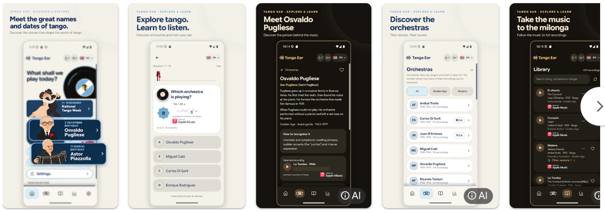
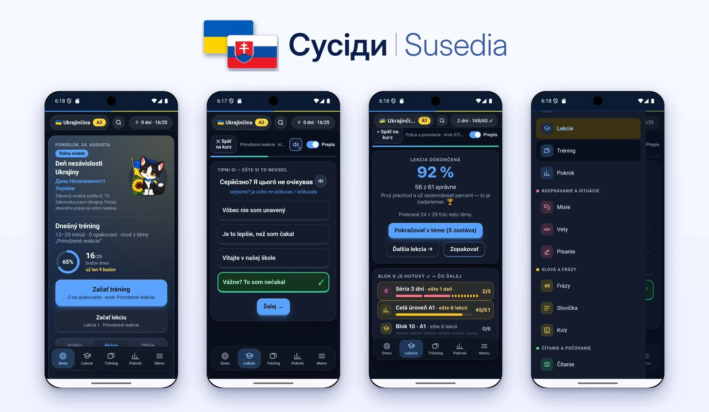

# Marek Demin – Portfolio

Three products I defined and built with AI coding tools (Claude Code, GPT Codex and Gemini). This repository contains descriptions and screenshots only.

## 1. Tango Ear – tango music recognition

In tango you choose how to dance by the orchestra, so recognising the orchestra, song and era helps you adapt to the music. Tango Ear teaches this through quizzes, spaced repetition and a "same song, different orchestras" mode, with 670 recordings by 25 orchestras in 12 languages. I started it for myself, and the tango dancers I showed it to were enthusiastic.

- **Status:** closed testing on Android (Google Play); an App Store release is planned.
- **My role:** solo founder and product owner. I defined the concept, product priorities, UX, monetisation (a one-time purchase instead of a subscription) and localisation (Slovak, English, Ukrainian, Argentine Spanish).
- **AI tools:** Claude Code, GPT Codex and Gemini for implementation and for iterating on the design against current Apple and Google guidelines.
- **Tech:** React web app, packaged for Android.

## 2. Daily Planner – adaptive day planning (PWA)

I juggle work, tango, language learning and strength training, and when the day slips, a static plan falls apart. This app builds the day from my goals and re-plans it when things change, shortening or dropping lower-priority blocks when time runs short. It also compares planned and actual time and can read Apple or Google calendars.

- **My role:** product owner. I wrote the requirements, including a "right now I'm doing…" mode, an "away from home" mode, notifications, and weekly and monthly summaries.
- **AI tools:** Claude Code, GPT Codex and Gemini designed the scheduling logic and implemented the app.

## 3. Susedia | Сусіди – Slovak–Ukrainian language learning (PWA)

Many Slovaks and Ukrainians live side by side but lack a shared way to learn each other's language, so I wanted both groups to learn from the same material. It started as Ukrainian stories with a Slovak translation next to each paragraph and grew into an app with vocabulary, exercises with real-time feedback, spaced repetition and an interface that switches between Slovak and Ukrainian. I also use it to learn Ukrainian myself.

- **My role:** product owner and main tester. I made the UX decisions (mobile-first, clear hints, unambiguous controls). I am looking for funding.
- **AI tools:** Claude Code, GPT Codex and Gemini for implementation, translations and content.
- **Quality:** automated Playwright tests, including simulated Kyiv-time dates. I separate what was verified by machine from what still needs a native speaker's review.

---

© 2026 Marek Demin. All rights reserved. Text and screenshots may not be reused without permission.
